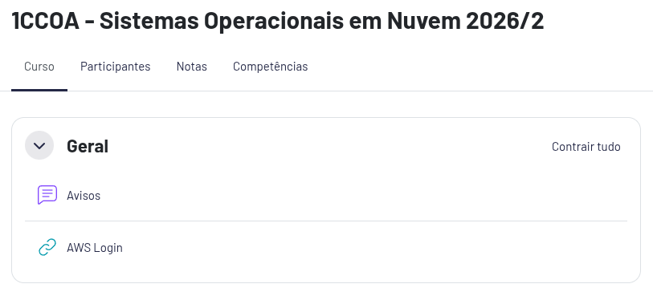
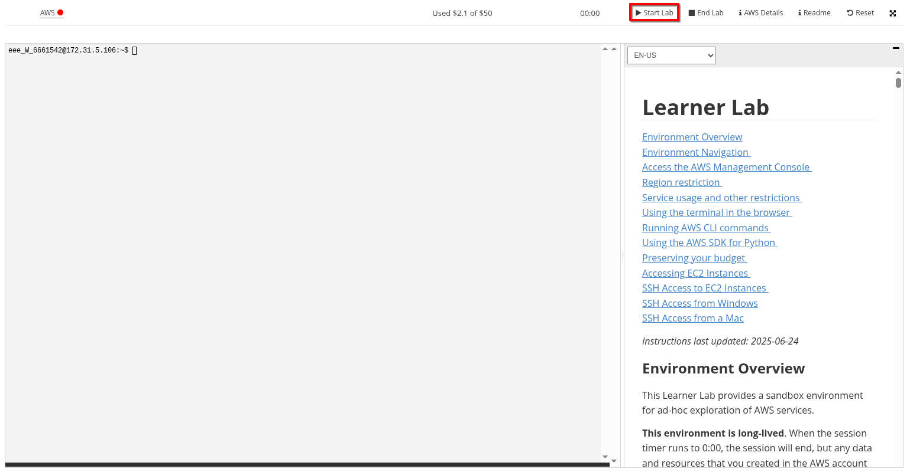
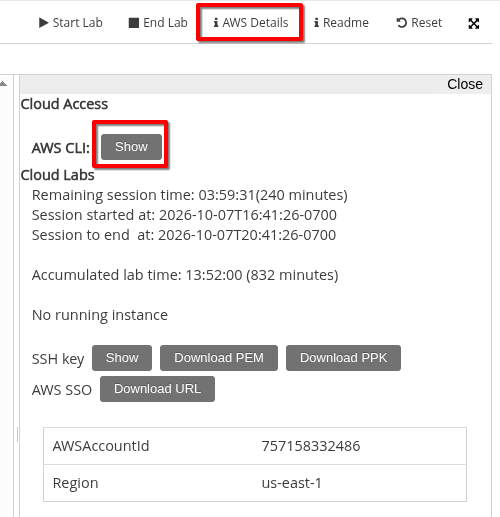
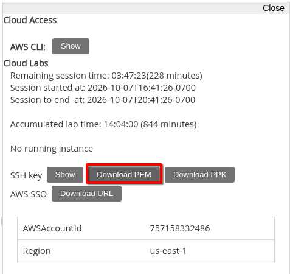
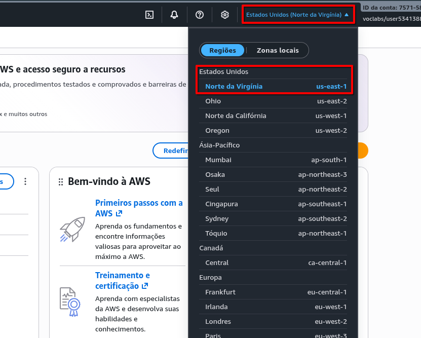
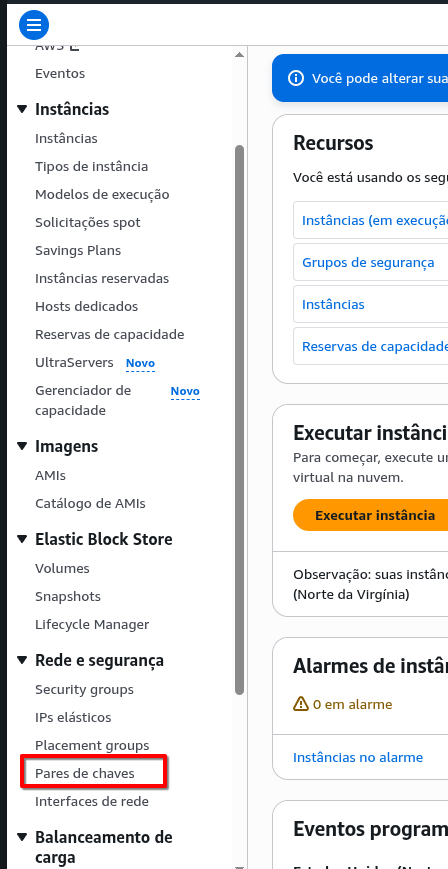
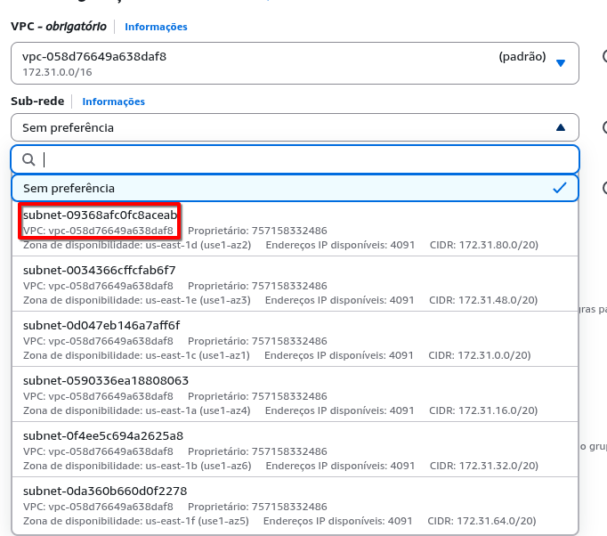

<a name="topo"></a>
<div align="center">
  <h1>Scripts AWS</h1>
  <p><strong>Criar e configurar instâncias EC2 na AWS</strong></p>
  <p>Automatiza a criação e configuração de servidores na nuvem AWS com scripts simples, mas eficientes</p>
  <p>
    <a href="#etapa-1">Arquivos</a> &nbsp;·&nbsp;
    <a href="#etapa-2">Preparar o computador</a> &nbsp;·&nbsp;
    <a href="#etapa-3">Credenciais do lab</a> &nbsp;·&nbsp;
    <a href="#etapa-6">Alterações obrigatórias no script</a> &nbsp;·&nbsp;
    <a href="#etapa-8">Execução do script</a> &nbsp;·&nbsp;
    <a href="#etapa-12">Exclusão</a>
  </p>
</div>

---

## Roteiro de execução

<details>
<summary><strong>Etapas do roteiro</strong></summary>

- [1. Baixar e conferir a pasta](#etapa-1)
- [2. Preparar o computador](#etapa-2)
- [3. Configurar as credenciais do AWS Academy Learner Lab](#etapa-3)
- [4. Preparar a chave de acesso pra EC2](#etapa-4)
- [5. Verificar o par de chaves na AWS](#etapa-5)
- [6. Escolher a sub-rede](#etapa-6)
- [7. Configurar o grupo de segurança](#etapa-7)
- [8. Conferir e executar o script](#etapa-8)
- [9. Preparar o acesso aos repositórios privados](#etapa-9)
- [10. Retomar a configuração da EC2](#etapa-10)
- [11. Confirmar a conclusão](#etapa-11)
- [12. Excluir a EC2 e seus volumes](#etapa-12)
- [13. Excluir o Data Lake](#etapa-13)

</details>

---

<a name="etapa-1"></a>

## 1. Baixar e conferir a pasta

Clone o repositório `scripts-aws`

Confira se estes seis arquivos estão juntos na mesma pasta:

- `criar-ec2.sh`: executado no seu **computador local** para criar a infraestrutura na AWS
- `configuracao.sh`: enviado automaticamente pelo primeiro script pra configurar a instância
- `preparar-github.sh`: executado na EC2 para gerar as chaves dos repositórios privados
- `atualizar-ec2.sh`: envia e executa o setup atual em uma EC2 existente
- `deletar-ec2.sh`: executado no **computador local** para deletar a infraestrutura na AWS
- `deletar-data-lake.sh`: executado no **computador local** para deletar a infraestrutura do Data Lake na AWS

Este roteiro utiliza esses seis arquivos para criar, configurar e deletar instâncias EC2 na AWS.

### Instalação do banco atualizado

O setup baixa `database/init-ec2.sql` da branch `main` e o executa somente em banco vazio.
Depois de validar as tabelas, o próprio setup cria `coretrace_schema_version` e registra
o checksum do SQL importado. O `init` não precisa incluir essa tabela de controle.
O esquema atual não possui a antiga tabela `container`.

Em novas execuções, um SQL diferente ou um banco antigo sem checksum interrompe o setup
com uma mensagem, preservando os dados. Atualizar o repositório não migra o banco.
Para testar uma instalação nova sem reutilizar a EC2 anterior, informe um nome exclusivo,
por exemplo `NOME=coretrace-ec2-init-teste bash criar-ec2.sh`, junto às configurações
de rede e IAM descritas neste roteiro. As deploy keys dos repositórios privados
precisam ser preparadas para cada nova EC2, conforme as etapas 9 e 10.

Se `bucket-coretrace` pertencer a outra conta, informe um nome exclusivo em
`BUCKET_DATALAKE`, por exemplo `BUCKET_DATALAKE=bucket-coretrace-ID_DA_CONTA`.
Use esse mesmo nome na configuração das aplicações que acessam o S3.
Na exclusão futura, passe o mesmo `BUCKET_DATALAKE` ao `deletar-data-lake.sh`;
o script continuará exigindo a confirmação do nome antes de apagar dados.

Antes de executar, será necessário preparar o terminal, configurar o acesso na AWS e preencher os dados da instância no script `criar-ec2.sh`

<p align="right"><a href="#topo">↑ Voltar ao topo</a></p>

---

<a name="etapa-2"></a>

## 2. Preparar o computador

Abra o terminal e confirme se a AWS CLI e o SSH estão instalados:

```bash
aws --version
ssh -V
```

A AWS CLI serve para executar os comandos da AWS. O SSH permite acessar a instância criada na nuvem.

Se os dois comandos mostrarem suas versões e a AWS CLI aparecer como `aws-cli/2...`, pode avançar para o próxmo passo.

**Caso algum programa esteja faltando:**

<details open>
<summary><strong>Ubuntu/Debian</strong></summary>

Em Ubuntu/Debian instale as ferramentas:

```bash
sudo apt update
sudo apt install -y curl unzip openssh-client
```

Se a AWS CLI estiver faltando, confira a arquitetura do computador:

```bash
uname -m
```

Para resultado `x86_64`, execute:

```bash
mkdir -p ~/Downloads/instalador-aws-cli
cd ~/Downloads/instalador-aws-cli
curl "https://awscli.amazonaws.com/awscli-exe-linux-x86_64.zip" -o awscliv2.zip
unzip awscliv2.zip
sudo ./aws/install
```

</details>

<details>
<summary><strong>Arch Linux</strong></summary>

Pra quem usa Arch Linux:

```bash
sudo pacman -Syu --needed aws-cli-v2 openssh
```

</details>

Quando terminar confirme se deu tudo certo com:

```bash
aws --version
ssh -V
```

Os dois comandos devem mostrar suas versões baixadas

<p align="right"><a href="#topo">↑ Voltar ao topo</a></p>

---

<a name="etapa-3"></a>

## 3. Configurar as credenciais do AWS Academy Learner Lab

**1. Iniciar o laboratório**

<details>
<summary><strong>Ver print</strong></summary>

<p align="center">
  
</p>

</details>

Acesse o AWS Academy Learner Lab pelo Moodle > SO em nuvem, e clique em **Start Lab**. Aguarde o indicador da AWS ficar verde.

<details>
<summary><strong>Ver print</strong></summary>

<p align="center">
  
</p>

</details>

**2. Copiar as credenciais**

Abra **AWS Details** e, na seção **AWS CLI**, clique em **Show**.

<details>
<summary><strong>Ver print</strong></summary>

<p align="center">
  
</p>

</details>

Copie todo bloco que contém estes campos:

```ini
[default]
aws_access_key_id=...
aws_secret_access_key=...
aws_session_token=...
```

**3. Salvar as credenciais no computador**

No terminal do seu computador, crie a pasta de configuração:

```bash
mkdir -p ~/.aws
chmod 700 ~/.aws
```

Abra o arquivo de credenciais em um editor. Por exemplo, se você tiver o Nano:

```bash
nano ~/.aws/credentials
```

Se já tiver dados, substitua pelos mais recentes que você acabou de pegar no console da AWS.

No Nano, salve com **Ctrl + O**, confirme com **Enter** e saia com **Ctrl + X**.

Restrinja o acesso ao arquivo:

```bash
chmod 600 ~/.aws/credentials
```

> [!WARNING]
> As credenciais devem ficar nesse arquivo separado. Não coloque elas no script, na pasta do projeto e MUITO MENOS no Github

**4. Testar a comunicação**

Execute sem o `sudo`:

```bash
aws sts get-caller-identity --region us-east-1 --no-cli-pager
```

Se funcionar, vai aparecer uma resposta com os campos `UserId`, `Account` e `Arn`. Isso confirma que o terminal conseguiu se autenticar na AWS usando as credenciais.

Se aparecer `ExpiredToken`, copie de novo as credenciais do laboratório da AWS e atualize o arquivo.

> [!WARNING]
> IMPOSTANTE: As credenciais são temporárias, quando elas expirarem ou quando você encerrar o laboratório, será necessário repetir esse passo para pegar novas credenciais atualizadas.

<p align="right"><a href="#topo">↑ Voltar ao topo</a></p>

---

<a name="etapa-4"></a>

## 4. Preparar a chave de acesso pra EC2

**1. Baixar a chave do laboratório**

Ainda no **AWS Details**, procure a opção **Download PEM** pra baixar a chave SSH.

<details>
<summary><strong>Ver print</strong></summary>

<p align="center">
  
</p>

</details>

Salve o arquivo no computador. Automaticamente, ele é baixado com o nome `labsuser.pem`, se não for esse o nome do arquivo, renomeie para `labsuser.pem`. Não altere a extensão do arquivo.

**2. Guardar a chave na pasta certa**

No terminal, execute:

```bash
mkdir -p ~/.ssh
chmod 700 ~/.ssh
```

Se a chave estiver em `~/Downloads/labsuser.pem`, copie para a pasta de chaves SSH:

```bash
cp -i ~/Downloads/labsuser.pem ~/.ssh/labsuser.pem
```

Se estiver em outra pasta, ajuste o caminho de origem.

**3. Ajustar a permissão da chave**

```bash
chmod 400 ~/.ssh/labsuser.pem
```

Essa permissão permite que só seu usuário leia a chave.

**4. Conferir o arquivo**

```bash
ls -l ~/.ssh/labsuser.pem
```

A linha das permissões deve aparecer assim no começo:

```bash
-r--------
```

> [!WARNING]
> A chave `.pem` é privada. Nunca coloque o conteúdo dela no script e nem envie o arquivo pro GitHub.

<p align="right"><a href="#topo">↑ Voltar ao topo</a></p>

---

<a name="etapa-5"></a>

## 5. Verificar o par de chaves na AWS

**1. Abra o console da AWS**

Clique em **AWS** com a bolinha verde para abrir o console.

**2. Conferir a região**

No canto superior direito do console, selecione **Norte da virgínia — `us-east-1`** se não tiver selecionado. Essa é a região usada no script e precisa estar batendo.

<details>
<summary><strong>Ver print</strong></summary>

<p align="center">
  
</p>

</details>

**3. Abrir lista de pares de chaves**

Na barra de pesquisa digite **EC2** e abra o serviço

No menu lateral do EC2, procure a seção **Rede e segurança**

Clique em **Pares de chaves**

<details>
<summary><strong>Ver print</strong></summary>

<p align="center">
  
</p>

</details>

**4. Procurar o par `vockey`**

Na lista, procure um par que o nome seja exatamente:

```text
vockey
```

Se ele aparecer, o nome corresponde ao valor configurado no script:

```bash
CHAVE="${CHAVE:-vockey}"
```

O nome `vockey` identifica o par na AWS. O arquivo `labsuser.pem` é a chave privada baixada do laboratório e salva no computador. Esse é o "par"

<p align="right"><a href="#topo">↑ Voltar ao topo</a></p>

---

<a name="etapa-6"></a>

## 6. Escolher a sub-rede

**1. Localizar as configurações de rede**

Ainda na tela **Executar instância**, vá até **Configurações de rede** e clique em **Editar**.

**2. Conferir a VPC**

No campo **VPC**, selecione a rede padrão e anote o **ID da VPC**, que começa com `vpc-`. O grupo de segurança escolhido na próxima etapa deve pertencer a essa mesma VPC.

**3. Selecionar uma sub-rede**

No campo **Sub-rede**, selecione uma opção dessa mesma VPC e copie seu id que começa com

```text
subnet-
```

<details>
<summary><strong>Ver print</strong></summary>

<p align="center">
  
</p>

</details>

Pro acesso SSH pela internet funcionar, a sub-rede precisa ter uma rota para um **Internet gateway**.

**4. Preencher o script**

No arquivo `criar-ec2.sh`, localize:

```bash
SUBREDE="${SUBREDE:-}"
```

Substitua pelo ID escolhido:

```bash
SUBREDE="subnet-ID_COPIADO"
```

A nível de curiosidade: O script já solicita um IP público para a EC2. A rota para o Internet gateway que dá pra consultar noo serviço VPC > Subredes > Tabela de rotas permite que esse IP seja usado para o acesso pela internet

<p align="right"><a href="#topo">↑ Voltar ao topo</a></p>

---

<a name="etapa-7"></a>

## 7. Configurar o grupo de segurança

**1. Abrir os grupos de segurança**

No console, acesse **EC2 → Rede e segurança → Grupos de segurança**.

**2. Escolher ou criar um grupo**

Clique em **Criar grupo de segurança** e preencha:

- **Nome:** `coretrace-sg`
- **Descrição:** `Acesso SSH a EC2 do Coretrace`
- **VPC:** a mesma VPC da sub-rede escolhida na fase anterior

**3. Liberar o acesso SSH**

Nas **Regras de entrada**, adicione:

| Campo | Valor |
|---|---|
| Tipo | SSH |
| Protocolo | TCP |
| Porta | 22 |
| Origem | Meu IP |

A origem deve mostrar seu IP público seguido de `/32`.

Para restringir o SSH aos IPs autorizados, não pode existir outra regra liberando a porta 22 para `0.0.0.0/0`

**4. Conferir as regras de saída**

Para a configuração automática baixar pacotes e imagens Docker, mantenha a regra de saída padrão:

- **Tipo:** Todo o tráfego / All traffic
- **Destino:** `0.0.0.0/0`

Clique em **Criar grupo de segurança**

**5. Copiar o ID do grupo**

Copie o **ID do grupo de segurança**, que começa com `sg-`.

No arquivo `criar-ec2.sh`, localize:

```bash
GRUPO="${GRUPO:-}"
```

Substitua pelo ID real:

```bash
GRUPO="sg-ID_COPIADO"
```

Salve o arquivo

<p align="right"><a href="#topo">↑ Voltar ao topo</a></p>

---

<a name="etapa-8"></a>

## 8. Conferir e executar o script

Esta etapa deve ser feita **somente pelo integrante responsável por criar a EC2**, no computador local.

**1. Abrir o terminal na pasta `scripts-aws`**

Abra o terminal na pasta onde estão os seis scripts.

**2. Conferir os dados no `criar-ec2.sh`**

A sub-rede e o grupo de segurança devem estar preenchidos com os IDs do seu laboratório, como foi mostrado nas etapas anteriores:

```bash
SUBREDE="subnet-ID_COPIADO"
GRUPO="sg-ID_COPIADO"
```

Não copie os IDs do laboratório de outra pessoa. Esses dados ficam na sua cópia local, não precisam ir pro GitHub.

A imagem pode continuar assim:

```bash
IMAGEM="${IMAGEM:-}"
```

Se estiver vazia, o script procura uma imagem oficial do Ubuntu Server 26.04 LTS na região `us-east-1` automaticamente.

**3. Preencher o perfil IAM pra acessar o S3**

O perfil IAM dá permissão pros programas da EC2 acessarem o bucket. Ele é separado das credenciais que você colocou no computador.

No terminal local, confira os perfis disponíveis no laboratório:

```bash
aws iam list-instance-profiles --query 'InstanceProfiles[].InstanceProfileName' --output table --no-cli-pager
```

Se aparecer `LabInstanceProfile`, localize esta linha no `criar-ec2.sh`:

```bash
PERFIL_IAM="${PERFIL_IAM:-}"
```

E substitua por:

```bash
PERFIL_IAM="LabInstanceProfile"
```

Se esse perfil não aparecer ou der erro de permissão, confira no console qual perfil o laboratório permite usar antes de continuar. O perfil precisa ter acesso ao bucket `bucket-coretrace`.

Salve o arquivo. Com os dados preenchidos nele, não precisa passar essas informações no comando.

**4. Verificar a sintaxe dos scripts**

Execute os comandos separadamente:

```bash
bash -n criar-ec2.sh
```

```bash
bash -n configuracao.sh
```

Se não aparecer nenhuma mensagem, a sintaxe passou na verificação. Se aparecer um erro, corrija antes de continuar.

**5. Executar a criação**

Execute **sem `sudo`**:

```bash
bash criar-ec2.sh
```

Esse comando cria ou reutiliza o bucket `bucket-coretrace`, prepara os prefixos `raw`, `trusted` e `client` e cria a EC2 caso não exista uma instância com o nome configurado.

O `configuracao.sh` é enviado automaticamente pra executar dentro da EC2.

**6. Aguardar a primeira configuração**

Mantenha o terminal aberto. O script vai aguardar a EC2 iniciar e vai tentar conectar por SSH.

Quando uma nova instância é criada, ele salva na pasta:

- `instancia-id.txt`: identificador da EC2.
- `instancia-ip.txt`: IP público da EC2.

**Na primeira vez, a configuração vai parar porque faltam as chaves dos repositórios privados.** A EC2 já foi criada, mas o projeto ainda não terminou de ser preparado. Continue na etapa 9, sem criar outra instância.

Se a mensagem só disser que a configuração apresentou problema, confira o log. No computador local, execute:

```bash
IP_EC2=$(cat instancia-ip.txt)
ssh -i ~/.ssh/labsuser.pem "ubuntu@$IP_EC2" 'sudo tail -n 80 /var/log/coretrace-configuracao.log'
```

Se aparecer que `database` é privado e falta a chave, siga pra próxima etapa. Se aparecer outro erro, confira a causa antes de continuar.

Se ocorrer `Connection timed out`, confira se seu IP público atual está liberado na porta 22 do grupo de segurança.

<p align="right"><a href="#topo">↑ Voltar ao topo</a></p>

---

<a name="etapa-9"></a>

## 9. Preparar o acesso aos repositórios privados

Os repositórios `database`, `api-java` e `scripts-captura` são privados. Pra EC2 conseguir baixar os arquivos, precisamos gerar e cadastrar uma chave de leitura pra cada um deles.

`website` e `api-filtro-de-captura` são públicos e não precisam dessas chaves. A IAM Role usada pro S3 não dá acesso ao GitHub.

**1. Enviar o auxiliar pra EC2**

No seu computador, ainda na pasta `scripts-aws`, execute:

```bash
IP_EC2=$(cat instancia-ip.txt)
scp -i ~/.ssh/labsuser.pem preparar-github.sh "ubuntu@$IP_EC2:/tmp/preparar-github.sh"
```

**2. Gerar as chaves dentro da EC2**

Execute este comando também no terminal do seu computador. Ele acessa a EC2 e roda o auxiliar lá:

```bash
ssh -i ~/.ssh/labsuser.pem "ubuntu@$IP_EC2" 'sudo bash /tmp/preparar-github.sh database api-java scripts-captura'
```

Vão aparecer três chaves públicas, cada uma com o nome do repositório correspondente. As privadas ficam na EC2, em `/etc/coretrace/github`, e não devem ser copiadas pro GitHub.

Essas chaves são diferentes da `labsuser.pem`, que é usada pra você entrar na EC2.

**3. Cadastrar as públicas no GitHub**

Em cada um dos três repositórios privados, abra **Settings > Deploy keys > Add deploy key**.

- Em **Title**, coloque um nome que identifique a EC2, por exemplo `EC2 Raphael`.
- Em **Key**, cole a pública daquele repositório, começando em `ssh-ed25519`, tudo em uma linha.
- Deixe **Allow write access desmarcado**.
- Clique em **Add key**.

Repita o cadastro nos três repositórios, com a chave correspondente a cada um. Não use a mesma deploy key nos três.

**4. Quando criar outra EC2**

Uma EC2 nova precisa das próprias chaves. As cadastradas pra outra instância não dão acesso sozinhas, porque precisam da privada correspondente. Se uma EC2 for excluída, as chaves dela no GitHub podem ser removidas quando não forem mais usadas.

<p align="right"><a href="#topo">↑ Voltar ao topo</a></p>

---

<a name="etapa-10"></a>

## 10. Retomar a configuração da EC2

Depois de cadastrar as três públicas, volte pro terminal do seu computador, na pasta `scripts-aws`, e execute **sem `sudo`**:

```bash
bash atualizar-ec2.sh
```

Sem passar argumento, ele usa o ID salvo em `instancia-id.txt`. Confira se esse arquivo é da EC2 que acabou de criar. Se quiser informar o ID diretamente:

```bash
bash atualizar-ec2.sh i-ID_DA_INSTANCIA
```

Esse script envia o `configuracao.sh` atual pra mesma EC2 e executa de novo. Não cria outra instância.

Pode aparecer um aviso de que o cloud-init anterior teve erro. Se o erro foi a falta das chaves que você acabou de cadastrar, é esperado. O setup vai tentar continuar agora com o acesso ao GitHub configurado.

Ele vai clonar os repositórios nas pastas do projeto, preparar o MySQL e importar as tabelas e dados iniciais se o banco estiver vazio.

Se o banco já foi inicializado por esse setup, os dados são preservados. Se encontrar tabelas sem o registro da instalação, ele para pra conferência, sem apagar o banco.

Mantenha o terminal aberto até terminar. Se aparecer outro erro, confira a mensagem antes de executar de novo.

<p align="right"><a href="#topo">↑ Voltar ao topo</a></p>

---

<a name="etapa-11"></a>

## 11. Confirmar a conclusão

Depois de retomar pelo `atualizar-ec2.sh`, devem aparecer as mensagens:

```text
CONFIGURAÇÃO CONCLUÍDA
```

```text
Setup atualizado. Aplicações ainda não foram iniciadas automaticamente.
```

Isso confirma que o setup terminou, os repositórios foram clonados e as verificações do banco passaram. Se a configuração já estiver completa na execução do `criar-ec2.sh`, ele mostra `Verificação automática concluída com sucesso.`

Pra acessar o servidor depois, execute no computador do responsável:

```bash
ssh -i ~/.ssh/labsuser.pem ubuntu@IP_PUBLICO_DA_EC2
```

Substitua `IP_PUBLICO_DA_EC2` pelo endereço atual da instância. Se ela foi desligada e ligada de novo, confira o IP no console, porque ele pode ter mudado.

**Essa entrega prepara o ambiente, os repositórios e o banco.** O site, a aplicação Java e os ETLs ainda não ficam rodando. Instalar as dependências das aplicações, preencher os `.env` e configurar a inicialização dos serviços é a próxima etapa.

<p align="right"><a href="#topo">↑ Voltar ao topo</a></p>

---

<a name="etapa-12"></a>

## 12. Excluir a EC2 e seus volumes

> [!WARNING]
> **A exclusão é definitiva:** os arquivos da EC2, os containers e os dados MySQL armazenados nos volumes excluídos serão perdidos. Faça backup dos dados que deseja guardar antes de continuar.

Na pasta `scripts-aws`, confira o ID salvo pelo script de criação:

```bash
cat instancia-id.txt
```

Confira no console se esse ID corresponde a instância que deseja excluir. Depois execute, sem `sudo`:

```bash
bash deletar-ec2.sh
```

O script mostra a conta AWS, a região, o ID e o nome da instância e os volumes EBS ligados a ela. Pra autorizar a exclusão, digite o ID completo da instância quando for solicitado. Qualquer outro texto cancela antes de alterar os recursos.

Para excluir outra instância do Coretrace, como por exemplo uma EC2 de teste, informe o ID completo dela no comando:

```bash
bash deletar-ec2.sh i-ID_DA_INSTANCIA
```

O script aceita instâncias com nome `coretrace-ec2` ou começando com `coretrace-ec2-`.

Ao terminar, deve aparecer:

```text
EC2 i-ID_DA_INSTANCIA e seus volumes EBS excluídos com sucesso.
```

O Data Lake S3, snapshots, VPC, sub-rede, grupos de segurança e pares de chaves são preservados.

<p align="right"><a href="#topo">↑ Voltar ao topo</a></p>

---

<a name="etapa-13"></a>

## 13. Excluir o Data Lake

O script `deletar-data-lake.sh` é separado da exclusão da EC2. Ele remove os objetos atuais e tenta excluir o bucket `bucket-coretrace`

Execute no computador local e sem `sudo`:

```bash
bash deletar-data-lake.sh
```

<p align="right"><a href="#topo">↑ Voltar ao topo</a></p>


## Preparação do projeto na EC2

Nesta entrega, somente o MySQL da aplicação roda no Docker. O MySQL instalado no sistema fica disponível em separado.

O `configuracao.sh` instala Git, Node.js, npm e Maven, além das ferramentas já existentes.
O setup seleciona explicitamente Java e javac 21 como padrão, mesmo quando o Maven
também instala uma versão mais recente do Java. Os repositórios são distribuídos
conforme sua função:

| Repositório | Destino na EC2 | Branch padrão | Variável para mudar a branch |
|---|---|---|---|
| website | /var/www/coretrace/website | dev | BRANCH_WEBSITE |
| api-java | /opt/coretrace/api-java | main | BRANCH_JAVA |
| api-filtro-de-captura | /opt/coretrace/api-filtro-de-captura | main | BRANCH_FILTRO |
| scripts-captura | /opt/coretrace/scripts-captura | main | BRANCH_CAPTURA |
| database | /opt/coretrace/database | main | BRANCH_DATABASE |

O repositório do site inteiro fica em `/var/www/coretrace/website`, mas somente
sua pasta `public` é servida pelo Express.
As APIs e o código do ETL ficam em `/opt/coretrace`. A pasta `database` contém
os arquivos SQL. Os dados reais do MySQL ficam no volume Docker
`coretrace_mysql_data`. Configurações do setup ficam em `/etc/coretrace`, e seu
log fica em `/var/log/coretrace-configuracao.log`.

Os repositórios públicos usam HTTPS. Os privados exigem as deploy keys da etapa 9.

### Atualizar uma EC2 existente

Se precisar aplicar uma correção no setup de uma EC2 que já existe, execute no
computador local, na pasta `scripts-aws`:

```bash
bash atualizar-ec2.sh i-ID_DA_INSTANCIA
```

Sem passar argumento, o ID é lido de `instancia-id.txt`. O script consulta o IP
atual, confere o nome e o estado da EC2 e envia o `configuracao.sh` local via SSH.
Não cria outra EC2.

Ele reaplica o setup inteiro, incluindo pacotes, usuários e SSH, e tenta atualizar
os repositórios. Se houver alterações locais, outra branch ou commits que não
permitam atualizar sem merge, ele para sem descartar esses arquivos e commits.

### S3 e acesso da EC2

O bucket escolhido é `bucket-coretrace`, com prefixos `raw/`, `trusted/` e `client/`.
Os nomes de bucket S3 são únicos entre contas na mesma partição AWS: se o nome estiver ocupado por outra conta, a criação falhará. Nenhum bucket ou objeto antigo
é renomeado, movido ou apagado pelo script de criação.

O `deletar-data-lake.sh` usa o mesmo bucket e exige digitar seu nome antes da exclusão.

O acesso dos programas ao S3 usa o perfil IAM preenchido no script na etapa 8.
O script não cria roles nem políticas e não copia as credenciais do computador
pra EC2. Se o perfil não tiver as permissões necessárias no bucket, o acesso ao
S3 precisa ser ajustado no laboratório.

### O que ainda falta para rodar as aplicações

Esta entrega prepara infraestrutura, código e banco. Não executa `npm install`,
`mvn package` ou a instalação das bibliotecas Python; não gera os `.env`, não
configura tokens Jira/Slack/e-mail, não inicia site/Java/ETLs. Esses passos exigem validação das configurações de cada aplicação.
